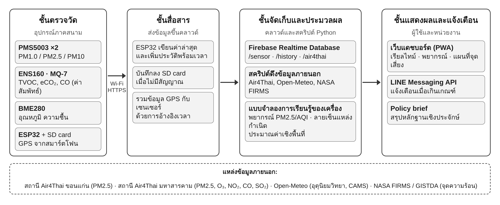

# ระบบตรวจวัดคุณภาพอากาศอัจฉริยะด้วย IoT
**Smart Air Quality Monitoring System Using IoT**

โครงงานวิทยาการคอมพิวเตอร์ มหาวิทยาลัยขอนแก่น · รายวิชา CP353761 สัมมนา

อุปกรณ์ IoT ต้นทุนต่ำวัดฝุ่น PM1.0/PM2.5/PM10 และก๊าซ (TVOC, eCO₂, CO) ในเมืองขอนแก่น แล้วใช้ข้อมูลร่วมกับสถานี Air4Thai, ข้อมูลอุตุนิยมวิทยา และจุดความร้อนจากดาวเทียม เพื่อสร้างหลักฐานเชิงประจักษ์ 3 ชุด

| หลักฐาน | คำถาม | วิธี |
|---|---|---|
| **เมื่อไร** | ฝุ่นจะเกินเกณฑ์ตอนไหน | พยากรณ์ PM2.5 ล่วงหน้า 1–6 ชม. (persistence, SARIMA, XGBoost, LSTM) และ backtest การแจ้งเตือน |
| **ที่ไหน** | จุดไหนในเมืองหนักกว่าสถานี | รอบวัดเคลื่อนที่ 12 รอบ → แผนที่เชิงสัมพัทธ์กริด 100 ม. (IDW, Kriging, Random Forest) |
| **เพราะอะไร** | มาจากการเผาหรือการจราจร | ลายเซ็นก๊าซ (PM+TVOC = เผา, PM+CO = จราจร) ร่วมกับจุดความร้อน NASA FIRMS ต้นลม |



## โครงสร้าง repo

```
├── firmware/esp32-air-monitor/   โค้ด ESP32 (config.h ไม่ถูก push)
├── docs/                         เว็บแดชบอร์ด (GitHub Pages)
│   ├── index.html                แดชบอร์ดปัจจุบัน อ่าน Firebase จริง
│   └── dashboard-v1.html         แดชบอร์ดรุ่นแรก
├── scripts/                      ดึงข้อมูลภายนอก (Air4Thai, Open-Meteo, NASA FIRMS)
├── analysis/                     notebook และโค้ด ML
├── data/                         ข้อกำหนดชุดข้อมูล (ไฟล์จริงไม่อยู่ใน git)
├── hardware/                     BOM วงจร รูปเครื่อง
├── report/                       เค้าโครง รูป สไลด์ policy brief
├── firebase/                     Database Rules และโครงสร้างข้อมูล
└── .github/workflows/            ดึง Air4Thai อัตโนมัติทุกชั่วโมง
```

## เริ่มใช้งาน

ทำตามลำดับนี้ ขั้นที่ 1–4 ทำได้เลยโดยยังไม่ต้องล็อก Database Rules

### 1. Clone repo

```bash
git clone https://github.com/Awmax001/Smart-Air-Quality-Monitoring-System-Using-IoT.git
cd Smart-Air-Quality-Monitoring-System-Using-IoT
```

### 2. ESP32 (Arduino IDE)

สรุปสั้น รายละเอียด วงจร และวิธีแก้ปัญหาอยู่ที่ [`firmware/esp32-air-monitor/README.md`](firmware/esp32-air-monitor/README.md)

1. Arduino IDE 2.x → Preferences → Additional boards manager URLs:
   `https://espressif.github.io/arduino-esp32/package_esp32_index.json`
2. Boards Manager → ติดตั้ง **esp32 by Espressif Systems**
3. คัดลอก `firmware/esp32-air-monitor/config.example.h` เป็น `config.h` แล้วใส่ Wi-Fi (2.4 GHz)
4. ตั้ง `USE_ENS160` / `USE_BME280` / `USE_MQ7` ตามเซนเซอร์ที่มี (ค่าเริ่มต้น 0 = มีแค่ PMS5003 ไม่ต้องลงไลบรารี)
   เมื่อได้ ENS160 / BME280 มา ให้ลงไลบรารี **SparkFun Indoor Air Quality Sensor - ENS160** / **Adafruit BME280 Library** แล้วเปลี่ยนเป็น 1
5. เปิด `esp32-air-monitor.ino` → Board **ESP32 Dev Module** → เลือก Port → Upload
6. Serial Monitor 115200 ต้องเห็น `Firebase OK` ทุก 10 วินาที

### 3. ตรวจข้อมูลใน Firebase

Firebase Console → Realtime Database ต้องเห็น `/sensor` เปลี่ยนทุก 10 วินาที และ `/history` เพิ่มรายการ

### 4. เว็บแดชบอร์ด

ดับเบิลคลิก `docs/index.html` เปิดในเบราว์เซอร์ได้ทันที หรือเปิด GitHub Pages:
**Settings → Pages → Deploy from a branch → `main` / `/docs`** แล้วเข้าที่ `https://awmax001.github.io/Smart-Air-Quality-Monitoring-System-Using-IoT/`

- ไม่ต้องตั้งค่า Firebase ในหน้าเว็บ ค่า config ของโปรเจกต์ใส่ไว้ใน `docs/index.html` แล้ว และหน้าเว็บแค่อ่านข้อมูล จึงไม่ต้องล็อกอิน
- หน้าเว็บเลือกเองว่าจะอ่าน `/history` (กราฟย้อนหลัง 24 ชม. ทันทีที่เปิด) หรือ `/sensor` (ถ้า ESP32 ยังใช้โค้ดเดิม) ถ้าเคยกดบันทึกการตั้งค่าไว้ก่อน ให้กด "ล้างค่าที่บันทึก" ในหน้าตั้งค่าหนึ่งครั้ง
- แท็บพยากรณ์และแหล่งกำเนิดยังเป็นข้อมูลจำลอง (มีป้ายกำกับบนหน้าเว็บ) จนกว่าโมเดลใน `analysis/` จะเสร็จ

### 5. ค่าสถานี Air4Thai → Firebase

เบราว์เซอร์ดึง Air4Thai ตรงไม่ได้ (CORS) จึงใช้สคริปต์เขียนค่าลง Firebase แทน

```bash
pip install -r scripts/requirements.txt
python scripts/air4thai_to_firebase.py --list ขอนแก่น              # หารหัสสถานี
python scripts/air4thai_to_firebase.py --station <รหัส> --dry-run  # ทดสอบ
python scripts/air4thai_to_firebase.py --station <รหัส> --once     # เขียนลง Firebase จริง
```

- ใส่รหัสเดียวกันที่ `air4thaiStation` ใน `docs/index.html` (หรือปุ่ม "ตั้งค่าการเชื่อมต่อ" บนหน้าเว็บ)
- ให้รันเองทุกชั่วโมง: แก้ `STATION_ID` ใน `.github/workflows/air4thai.yml` แล้วดูผลที่แท็บ **Actions**

### 6. ล็อก Database Rules

ทำตาม [`firebase/README.md`](firebase/README.md): สร้างบัญชีอุปกรณ์และบัญชีสคริปต์ → เพิ่ม uid ลง `/writers` → ใส่ `DEVICE_EMAIL` / `DEVICE_PASSWORD` ใน `config.h` แล้วอัปโหลด ESP32 ใหม่ → ตั้ง GitHub Secrets → Publish rules

### 7. ข้อมูลย้อนหลังและการวิเคราะห์

```bash
python scripts/fetch_open_meteo.py --start 2024-11-01 --end 2025-04-30
export FIRMS_MAP_KEY=...    # ขอฟรีที่ firms.modaps.eosdis.nasa.gov/api/map_key
python scripts/fetch_firms.py --start 2025-01-01 --end 2025-04-30 --source VIIRS_SNPP_SP

pip install -r analysis/requirements.txt
jupyter lab analysis/notebooks
```

รายละเอียดชุดข้อมูลอยู่ที่ [`data/README.md`](data/README.md)

## ความปลอดภัย

- **อย่า commit รหัส Wi-Fi** ใส่ไว้ใน `firmware/esp32-air-monitor/config.h` ซึ่งถูก ignore แล้ว
- Web API key ของ Firebase ในหน้าเว็บไม่ใช่ความลับ ความปลอดภัยมาจาก **Database Rules**
- ตอนนี้ Rules ยังเปิดให้ใครก็เขียนได้ ให้เปลี่ยนเป็น `firebase/database.rules.json` **หลังจาก** แก้ ESP32 ให้ล็อกอินแล้ว (ขั้นตอนใน [`firebase/README.md`](firebase/README.md)) ถ้าเปลี่ยนก่อน ESP32 จะเขียนไม่ได้

## สถานะ

- [x] ต้นแบบฮาร์ดแวร์ ESP32 + PMS5003
- [x] เว็บแสดงผลเรียลไทม์ + GPS + กราฟ
- [x] แดชบอร์ดอ่าน Firebase จริง + ค่าสถานี Air4Thai
- [x] เอกสารเค้าโครงโครงงาน
- [x] โค้ด ESP32 ส่ง `/sensor` + `/history` พร้อม timestamp และรองรับการล็อกอิน
- [ ] อัปโหลดโค้ดใหม่ลงเครื่องจริงและล็อก Database Rules
- [ ] เพิ่ม ENS160, MQ-7, BME280, PMS5003 ตัวที่ 2, SD card
- [ ] รวบรวมข้อมูลย้อนหลัง A1–A5 และประเมินเซนเซอร์
- [ ] โมเดลพยากรณ์ + backtest การแจ้งเตือน
- [ ] รอบวัดเคลื่อนที่ 12 รอบ + แผนที่จุดเสี่ยง
- [ ] ลายเซ็นก๊าซ + จุดความร้อนต้นลม
- [ ] แจ้งเตือนผ่าน LINE
- [ ] Policy brief

## การทำงานร่วมกัน

- แยก branch ต่องาน เช่น `feat/forecast`, `fix/air4thai` แล้วเปิด Pull Request ให้อีกคนรีวิวก่อน merge เข้า `main`
- `main` ต้องเปิดเว็บได้และรันสคริปต์ได้เสมอ (GitHub Pages ดึงจาก `main`)
- ข้อความ commit สั้นและบอกสิ่งที่เปลี่ยน เช่น `forecast: add XGBoost 6h backtest`

## ผู้จัดทำ

- นาย จีรภัทร แก้วดี
- นาย อนัตตา โยคาพจร

**อาจารย์ที่ปรึกษา:** อ.ดร.พบพร ด่านวิรุทัย

สาขาวิชาวิทยาการคอมพิวเตอร์ วิทยาลัยการคอมพิวเตอร์ มหาวิทยาลัยขอนแก่น

## แหล่งข้อมูลและสัญญาอนุญาต

โค้ดใน repo นี้ใช้สัญญาอนุญาต MIT (ดู [`LICENSE`](LICENSE))
ข้อมูลภายนอกเป็นของเจ้าของแต่ละแหล่ง ใช้ตามเงื่อนไขของแหล่งนั้น: กรมควบคุมมลพิษ (Air4Thai), Open-Meteo (ERA5 / Copernicus CAMS, CC BY 4.0), NASA FIRMS
